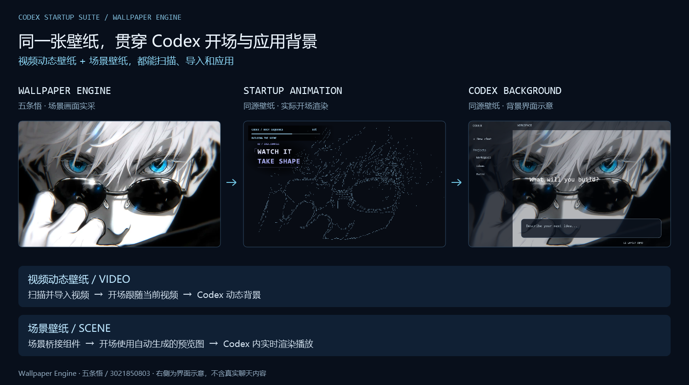
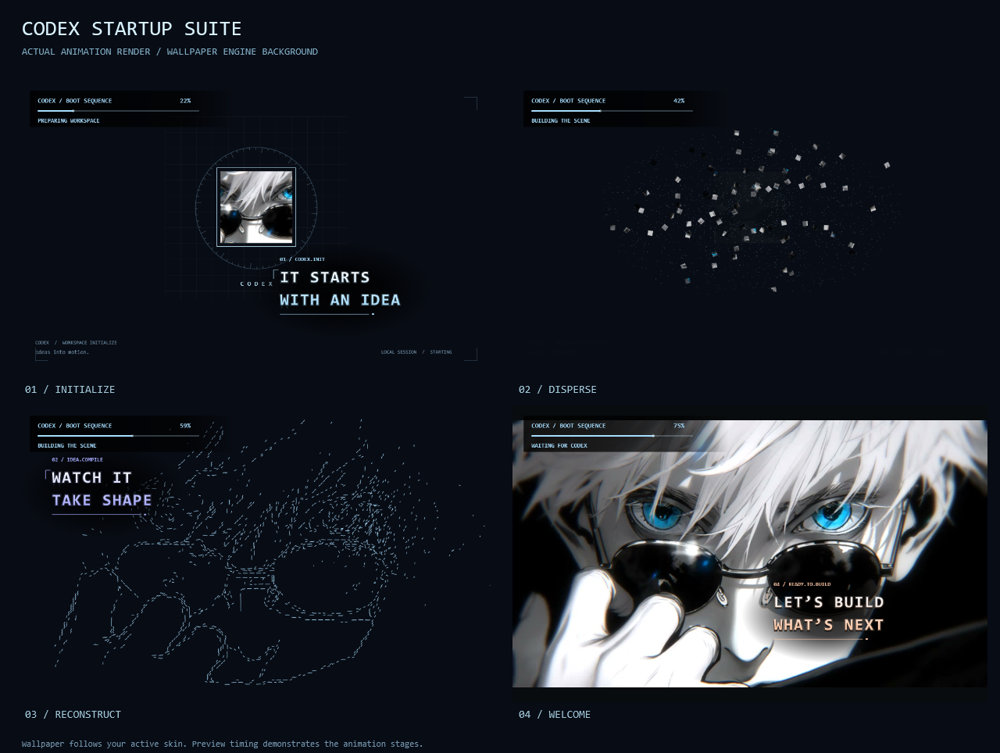

# Codex Startup Suite

把 **Wallpaper Engine 的视频动态壁纸和场景壁纸导入 Codex**：同一张壁纸，贯穿开场动画与应用背景。支持 Windows，并提供代理、皮肤和动画的统一启动入口。

这不是 OpenAI 官方项目。当前是 **v0.2.0 预览版**，适用于 Windows 11 x64、Microsoft Store 版 Codex 和 Codex Dynamic Skin **1.7.3**。代理入口要求已开启本机 HTTP 系统代理，不需要 TUN；它不保证服务端或代理节点永不重连。

**本次更新**：完整场景画面、多帧选图、自动字幕与配色适配、场景连接恢复、独立就绪交接以及冷启动提速。上次发布之后的完整差异见 [更新记录](CHANGELOG.md)。

## 核心效果：Wallpaper Engine → 开场动画 → Codex 背景



上图使用「五条悟」场景壁纸：左侧为 Wallpaper Engine 场景渲染画面，中间为程序实际渲染的开场动画，右侧为 **Codex 背景的界面布局示意**，展示同一张壁纸用于两处的效果。示意图不含真实聊天，也不是实机界面截图；实际应用内场景播放已经过本机验证。

| Wallpaper Engine 壁纸类型 | 导入皮肤管理器 | 开场动画 | Codex 应用背景 |
| --- | --- | --- | --- |
| 视频动态壁纸（Video） | 支持本地扫描、导入到主页、应用 | 跟随当前视频壁纸 | 动态视频播放 |
| 场景壁纸（Scene） | 支持本地扫描、导入到主页、应用 | 使用自动生成的场景预览图制作开场动画 | 由 Wallpaper Engine 实时渲染播放 |

**场景支持由本项目补做的通用桥接组件提供**：复用本机 Wallpaper Engine 渲染场景，将动态画面交给 Codex 的背景层，无需逐张录制或转换成 MP4。组件还兼容部分采用 `gifscene.pkg` 名称的场景包，并处理本地流传输和播放器退出。

新下载的视频与场景，在重新打开管理器的 **Wallpaper Engine** 列表时会自动扫描识别；然后选择 **导入到主页 → 应用到 Codex**。这是自动识别、手动导入，不会在后台自动切换皮肤。运行场景时保持 Wallpaper Engine 和皮肤管理器开启。

## 五条壁纸的开场效果

下面是程序使用同一张五条场景预览渲染的动画阶段。实际启动等待由应用就绪状态决定；场景在开场中使用预览图，应用内使用实时场景。




可使用 `scripts/Render-Preview.ps1 -FfmpegPath "C:\Tools\ffmpeg.exe" -PosterPath "C:\Previews\scene.jpg"` 重新生成动画预览。未提供 `PosterPath` 时使用原创示例背景。五条壁纸来源与画面权利说明见 [预览素材说明](docs/preview/ASSET_NOTICE.md)；仓库不附完整壁纸原素材。

## 功能

- 扫描并导入 Wallpaper Engine 的视频动态壁纸和场景壁纸，应用到 Codex 皮肤。
- 开场跟随当前选中的 Wallpaper Engine 壁纸；更换皮肤后自动读取新素材。
- 新增场景桥接组件，场景由 Wallpaper Engine 实时渲染，无需逐张转视频。
- 从真实场景中选取完整预览，避开黑帧，保持画面比例；视频预览与播放起点同步。
- 本地自动分析画面，调整字幕、进度条、颜色和对比度，复杂或过暗画面自动使用柔和淡入。
- 以当前窗口和当前皮肤独立判断交接，后台检查继续运行时也可以进入应用；启动失败时保留现有客户端。
- 缩短冷启动初期重试间隔，加快本机端口归属查询；具体耗时取决于应用、场景和设备。
- 英文科技感字幕、多阶段开场、进度条和贴合应用窗口的淡出交接；不显示 Esc 按钮，仍可按 Esc 跳过。
- 场景背景默认输出 1280×720、15 FPS；鼠标交互不转发给壁纸。
- 每次打开管理器的 Wallpaper Engine 列表重新扫描。新场景是**自动识别、手动导入**，不在后台自动切换皮肤。
- 保留本机代理参数和皮肤调试参数，统一启动应用。

## 安装

1. 下载 [Windows x64 v0.2.0 预览包](downloads/codex-startup-suite-v0.2.0-windows-x64.zip)（在文件页面点击 Download raw），完整解压到可写的固定目录。仓库的源码 ZIP 需要先运行 `Build.ps1`。
2. 安装 Microsoft Store 版 Codex。准备来自 [Codex Dynamic Skin v1.7.3](https://github.com/CCDawn/Codex-Dynamic-Skin/releases/tag/v1.7.3) 的 `CodexDreamSkinManager.exe`；安装程序只接受已核对的文件摘要，其他版本会停止。
3. 安装场景功能时需自行购买、安装并启动 [Wallpaper Engine](https://store.steampowered.com/app/431960/Wallpaper_Engine/)。项目不分发壁纸或引擎。
4. 在 Windows PowerShell 5.1 中运行：

   ```powershell
   powershell.exe -NoProfile -ExecutionPolicy RemoteSigned -File .\scripts\Get-VideoTool.ps1
   powershell.exe -NoProfile -ExecutionPolicy RemoteSigned -File .\Install.ps1 -ManagerPath "C:\YourDownloads\CodexDreamSkinManager.exe"
   ```

   视频工具从 Gyan 的固定版本地址下载，安装前核对 SHA-256；源码与许可证链接见 [第三方说明](THIRD_PARTY_NOTICES.md)。也可将同一版本的 `ffmpeg.exe` 通过 `-FfmpegPath` 传给安装程序。
5. 开启本机 HTTP 系统代理；从桌面 **Codex Startup Suite** 打开。首次在皮肤管理器中选择并应用壁纸；之后从同一入口启动即可显示动画。未选择壁纸时会跳过动画，继续启动流程。

系统若阻止未签名程序或下载脚本，请先检查系统给出的原因和文件来源；本工具不会修改系统安全策略。解压位置需要允许脚本与程序运行。

从旧版升级时，先正常退出 Codex、管理器和场景播放，在旧目录运行 `Uninstall.ps1` 移除匹配的启动挂接，再把新包解压到新的固定目录并安装。皮肤库和聊天由原应用保留。本工具不会覆盖不认识的已有文件。

## 使用

- 选择场景：管理器 **Wallpaper Engine → 选择场景 → 导入到主页 → 应用到 Codex**。保持管理器和 Wallpaper Engine 运行。
- 动画设置：安装后使用桌面 **Codex Startup Settings** 快捷方式。
- 自动适配默认开启；可在安装目录 `dragon-codex-boot/launcher.json` 将 `AutoAesthetics` 改为 `false` 关闭。画面分析完全在本机完成，缓存可重新生成。
- 只读检查：`powershell.exe -NoProfile -File .\codex-proxy\start-codex-with-skin.ps1 -CheckOnly`。
- 不播放动画：为启动脚本添加 `-WithoutAnimation`。
- 卸载集成：先正常退出本工具的管理器和场景播放，再运行 `Uninstall.ps1`。它只移除本工具创建的快捷方式和可确认的启动挂接，不删除聊天、壁纸或皮肤库。恢复官方界面和关闭调试端口，请在皮肤管理器中恢复官方外观并正常重启 Codex。

## 已知范围

进度条表示动画、界面准备与窗口对齐阶段，不是下载进度，也不是 Codex 内部真实完成百分比。应用没有准备好时不会仅凭计时宣布完成；等待超过上限会退出覆盖层。

场景交互不转发鼠标，输出流不含音轨；Wallpaper Engine 自身声音仍由其设置管理。首次生成可信场景预览前，开场显示中性加载画面，真实预览到达后再更新，不把缩略图伪装成完整场景。新版 Codex、皮肤管理器或显卡驱动可能需要重新验证。

自动审美采用本地显著区域和色彩估计，不能保证识别人脸或为所有构图找到理想布局。一个安装环境中，重试优化后的冷启动约 25 秒；后续原生查询优化尚无新的完整冷启动数据。应用已运行时的动画预览时长不能代替冷启动耗时。

皮肤依赖 `127.0.0.1:9335` 本机调试连接。同机其他程序也可能访问这个端口；仅绑定回环地址不会提供身份认证。不要将它转发到外网。

原安装环境验证过 25 张本机场景渲染和解码，以及一张场景在实际 Codex 中的视频推进、切回视频和退出清理。这不等于所有场景、所有电脑或新版应用均已验证。公开包的离线验证与安装测试见 [验证说明](docs/VALIDATION.md)。

## 开发

使用 Windows 自带的 .NET Framework 4.x C# 编译器，无 NuGet 依赖。Node.js 22+ 用于传输模块测试；运行时复用皮肤管理器已校验的 Node。

```powershell
powershell.exe -NoProfile -File .\Build.ps1
powershell.exe -NoProfile -File .\Test.ps1
powershell.exe -NoProfile -File .\scripts\Pack.ps1
```

源码模块：`codex-proxy`（统一入口）、`dragon-codex-boot`（动画）、`codex-scene-bridge`（场景桥接）。不包含官方 Codex 安装包、第三方管理器、FFmpeg 二进制或完整壁纸素材。许可证与上游来源见 [THIRD_PARTY_NOTICES.md](THIRD_PARTY_NOTICES.md)。
